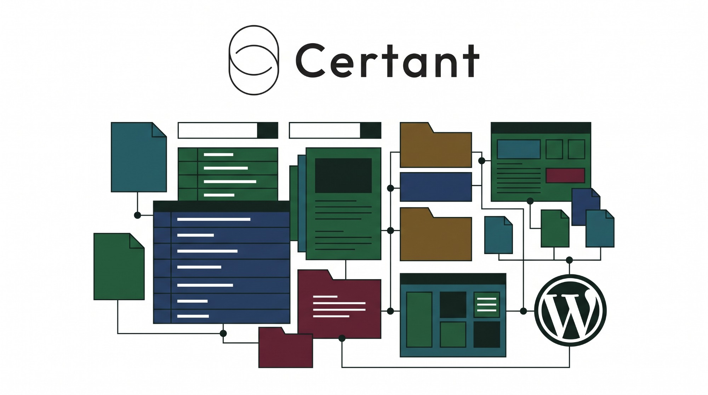
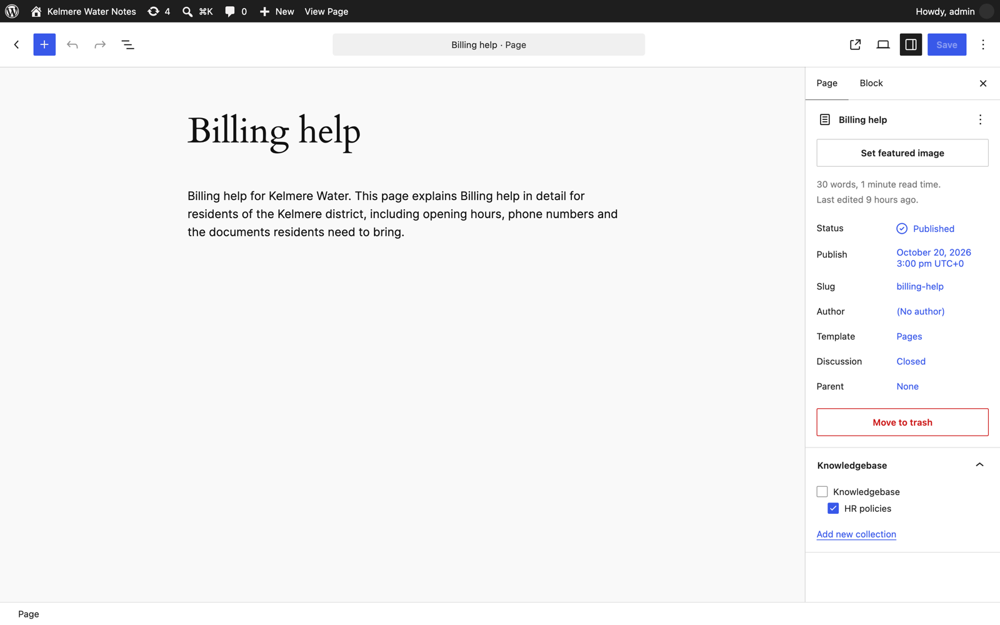
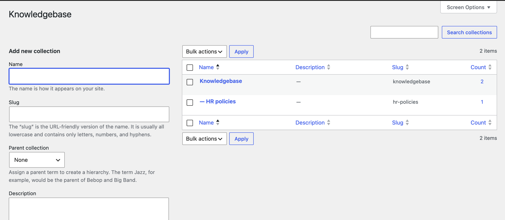
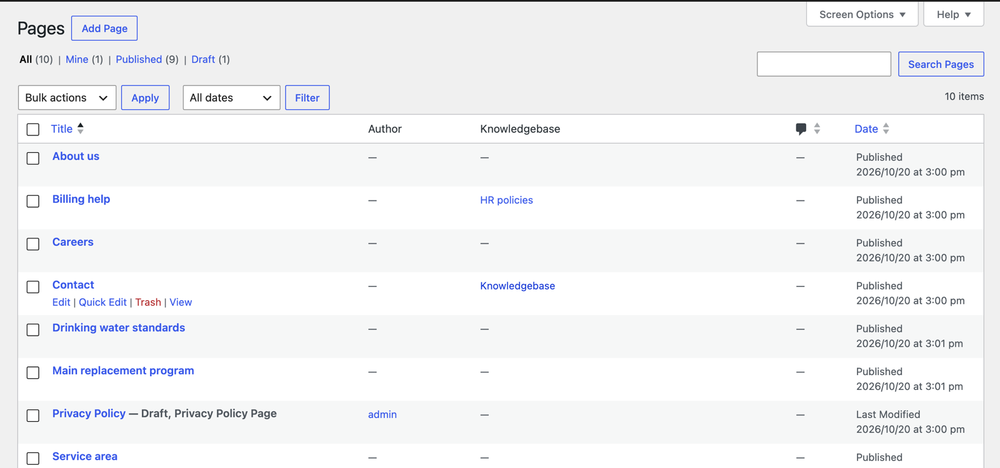
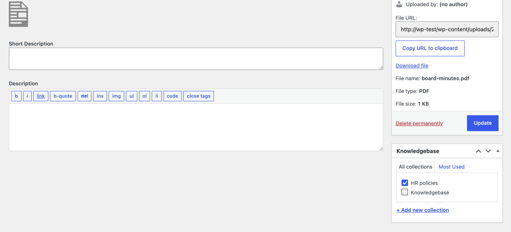

<p align="center">
  
</p>

<p align="center">
  <a href="https://github.com/certant-ai/certant-knowledgebase-plugin/releases/latest"></a>
  
  
  <a href="https://github.com/certant-ai/certant-knowledgebase-plugin/actions/workflows/ci.yml"></a>
  
  <a href="LICENSE"></a>
</p>

# Certant Knowledgebase

Choose in WordPress which posts, pages and files go into your [Certant](https://certant.ai) knowledgebase.

The plugin adds a **Knowledgebase** box to the editor and the media library. Tick a collection and that content is imported into Certant on the next sync. Untick it and it is removed. Your editors keep working in WordPress; nobody has to upload anything twice.

<p align="center">
  
</p>

## Install

**1. Download** [`certant-knowledgebase.zip`](https://github.com/certant-ai/certant-knowledgebase-plugin/releases/latest/download/certant-knowledgebase.zip) from the [latest release](https://github.com/certant-ai/certant-knowledgebase-plugin/releases/latest).

**2. Upload** it in WordPress: **Plugins → Add New Plugin → Upload Plugin**, choose the zip, then **Install Now**.

**3. Activate** it. A first collection, *Knowledgebase*, is ready to use.

Or with WP-CLI:

```bash
wp plugin install https://github.com/certant-ai/certant-knowledgebase-plugin/releases/latest/download/certant-knowledgebase.zip --activate
```

> Use the release zip, not GitHub's green **Code → Download ZIP** button. That one is the source repository, not the plugin WordPress expects.

## Use it

**File content.** Open a post or page and tick a collection in the **Knowledgebase** panel. For a PDF, Word, Excel or PowerPoint file, open it from **Media → Library**, choose **Edit more details** and tick a collection there. A file uploaded to a post or page follows that post or page, so you only need to tick the files that stand alone.

**Organise collections.** Go to **Pages → Knowledgebase** (also under Posts and Media). Collections nest like categories, so *HR policies* can sit inside *Knowledgebase* and syncing *Knowledgebase* includes it.

**See what's in.** The Posts, Pages and Media lists get a **Knowledgebase** column. Click a collection name to list everything in it.

| Collections | Pages list | A file in the media library |
|---|---|---|
|  |  |  |

## Connect it to Certant

In Certant, go to **Connections → WordPress** and enter your site's address. On **Sources**, tick Posts, Pages and **Files from the media library**, pick your collections under **Knowledgebase**, and choose how often to sync. Only content in those collections, or their sub-collections, is imported. Content you untick, unpublish or delete leaves the knowledgebase on the next sync.

## What the plugin does, and doesn't

It is one PHP file, [`certant-knowledgebase.php`](certant-knowledgebase.php), about 120 lines and most of those are labels and comments. You can read all of it before you install it.

- **Does:** register one taxonomy, `certant_kb`, on posts, pages and media, and share it through the WordPress REST API, which is how Certant reads it.
- **Doesn't:** add anything to your public site (no archive pages, URLs or menus), store settings, make outbound requests, track anyone, or load scripts or styles.
- **Visible over REST:** like categories and tags, the names of your collections and which *published* content is in them can be read at `/wp-json/wp/v2/certant_kb`. Private and draft content stays private. Don't put anything confidential in a collection name.

## Custom post types

Posts, pages and media are covered out of the box. To include another type, for example a docs plugin's, add this to your theme's `functions.php` or a small plugin:

```php
add_filter( 'certant_kb_post_types', function ( $types ) {
	$types[] = 'docs'; // the post type's name
	return $types;
} );
```

## Update and remove

**Update:** download the new zip and upload it the same way. WordPress asks to **Replace current with uploaded**; your collections are kept.

**Remove:** deactivate and delete it from **Plugins**. Your collections stay in the database, so reinstalling brings them back. To remove them too, delete the collections under **Pages → Knowledgebase** first.

## Verify the download

Each release is built and tested by [GitHub Actions](.github/workflows/release.yml) from the tagged commit, and ships with a SHA-256 checksum and a signed build provenance attestation:

```bash
shasum -a 256 -c certant-knowledgebase.zip.sha256
gh attestation verify certant-knowledgebase.zip --repo certant-ai/certant-knowledgebase-plugin
```

## Development

```bash
tests/smoke.sh 6.0      # installs the built zip into WordPress 6.0 in Docker and checks the REST API
tests/smoke.sh latest
composer install && composer lint   # WordPress Coding Standards, PHP 7.4+ compatibility
bin/build-zip.sh        # builds dist/certant-knowledgebase.zip
```

CI runs all three on every pull request. To release, bump `Version:` in `certant-knowledgebase.php` and `Stable tag:` in `readme.txt`, then push a tag such as `v1.0.1`.

Issues and pull requests are welcome.

## License

[GPL v2 or later](LICENSE), like WordPress.
